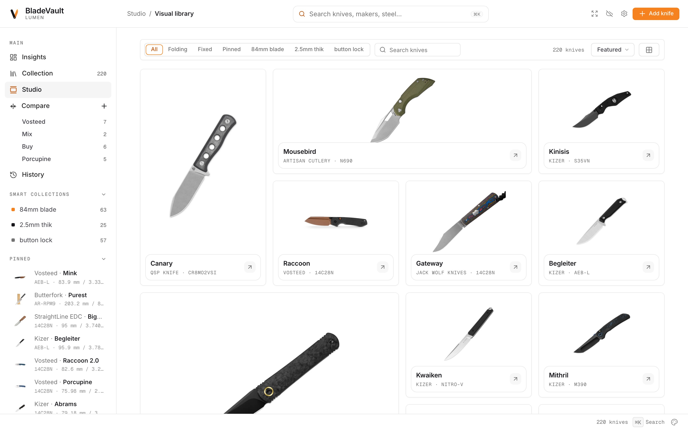
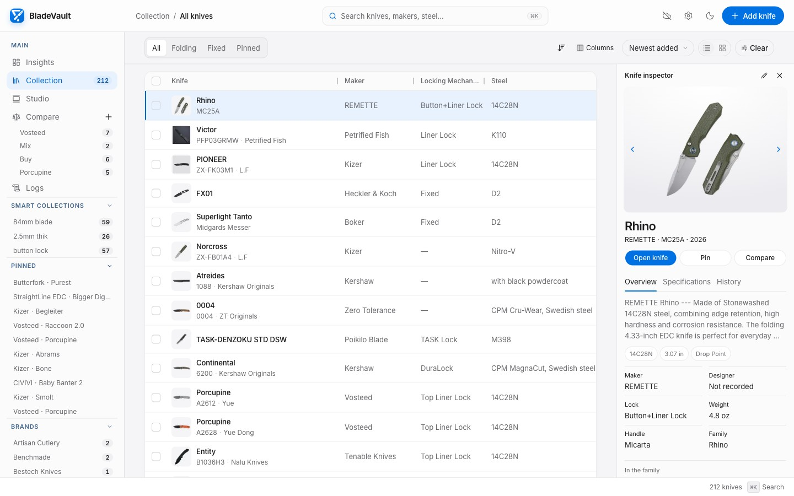
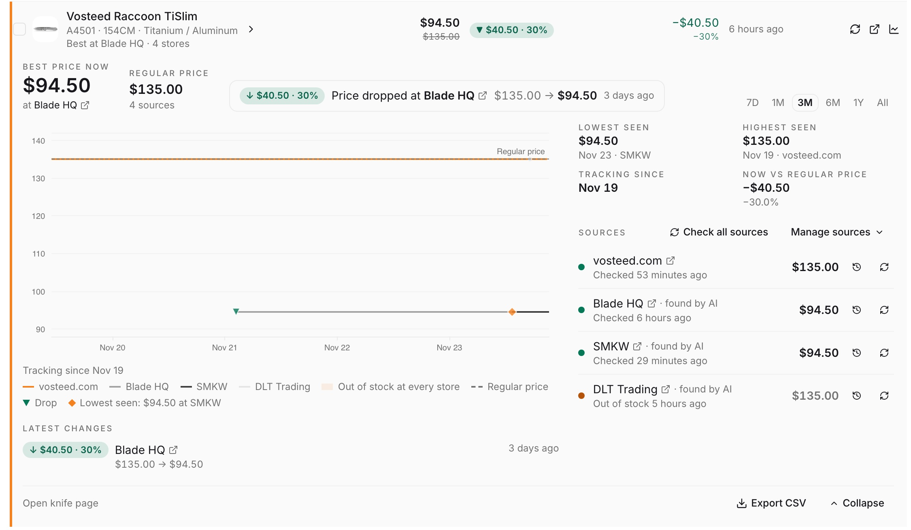
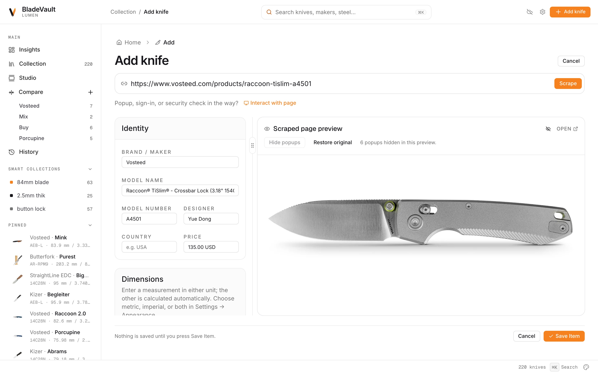
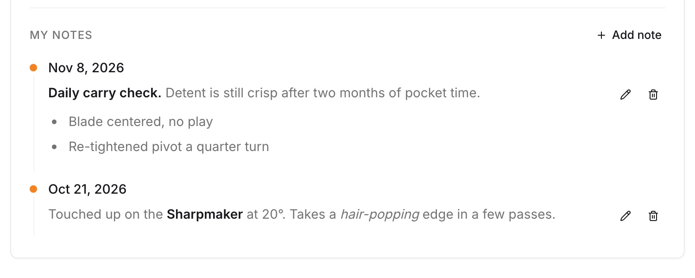

# BladeVault Web

[](https://nextjs.org/)
[](https://react.dev/)
[](https://www.typescriptlang.org/)
[](https://tailwindcss.com/)
[](https://workers.cloudflare.com/)

Promo website for [BladeVault](https://github.com/dedkola/bladevault), the local-first knife collection manager, live at [bladevault.pro](https://bladevault.pro). This repository contains the marketing site, docs, and release notes, not the main app codebase.

## About

The site is built with Next.js 16, React 19, TypeScript, and Tailwind CSS 4, and ships as a fully static export served by Cloudflare Workers. Most of the product is shown through coded, animated app windows built from the site's theme tokens, so they look right in both light and dark mode, with real knife photos from the example vault.

The homepage covers BladeVault 2.6 in these sections:

- **Hero** – a switchable app window that plays Chat, Wishlist, and Price Drops scenes in turn (pause, arrow keys, no autoplay with reduced motion), with "New" chips and an announcement bar driven by the newest featured release.
- **AI chat** (`#ai`) – a scripted copy of the in-app Chat page, an MCP demo player (add a knife in one line, price drops, blades over 4″, missing data), the 21 MCP tools grouped by area, a Chat vs MCP comparison, and an MCP setup generator that gives a copy-ready command or config for Claude Code, Claude Desktop, and other clients.
- **Wishlist** (`#wishlist`) – the deal board with best deals, a super sale block, and per-store price charts.
- **Import** (`#import`) – paste a product URL and get a filled record.
- **Collection** (`#collection`) – Notes, Maintenance, and History tabs.
- **Everywhere** (`#everywhere`) – Every screen, Google Drive backup, and App lock tabs.
- **Features** (`#features`) – the rail of background features, each opening a tour popup, plus themes and everything else.

Beyond the homepage, the site serves:

- `/features` and `/features/<slug>` – indexable pages for Chat, Wishlist, Price Drops, AI supervisor, Inbox, Maintenance, and Achievements. `#feature-<slug>` links open the matching tour popup on the homepage.
- `/whats-new` – curated release notes, with a version table of contents on desktop and a "Jump to a release" disclosure on smaller screens.
- `/docs` – documentation rendered from markdown fetched from the main repository at build time.
- `/tutorials` – video tutorials.
- `/compare` – BladeVault compared with spreadsheets, generic inventory apps, and DIY databases.
- `/privacy` and `/terms` – legal pages.

If you need the application itself, use the main [BladeVault repo](https://github.com/dedkola/bladevault).

## Product Screenshots

<div align="center">

  
  <p><sub>Studio — the collection as a visual library</sub></p>

  
  <p><sub>Collection — search, filter, pin, and inspect every knife</sub></p>

  
  <p><sub>Price Drops — every store on one chart, with the best price now</sub></p>

  
  <p><sub>Add knife — paste a product URL and BladeVault fills the record</sub></p>

  
  <p><sub>Notes — dated notes for every knife</sub></p>

</div>

## Project Structure

- `app/` - Next.js routes, layout, metadata routes (sitemap, robots, manifest, icons, Open Graph image), and global styles
- `app/page.tsx` - homepage assembled from reusable sections
- `app/features/` - `/features` index and per-feature pages
- `app/docs/` - documentation pages rendered from markdown fetched at build time
- `app/whats-new/page.tsx` - curated BladeVault release notes
- `app/tutorials/`, `app/compare/`, `app/privacy/`, `app/terms/` - remaining site routes
- `components/sections/` - homepage blocks, including the hero window, Chat and MCP demos, MCP setup generator, Wishlist, and tabbed sections
- `components/features/` - feature rail, cards, tour popups, and their app mocks
- `components/site/` - shared site chrome such as header, footer, and announcement bar
- `components/docs/`, `components/tutorials/`, `components/legal/`, `components/competition/` - page-specific components
- `components/ui/` - reusable UI primitives
- `data/releases.json` - release notes data behind `/whats-new`, the announcement bar, and the hero chips
- `lib/site.ts` - shared site metadata, download links, screenshot paths, and video configuration
- `lib/features.ts` - copy and steps for the feature rail, tour popups, and `/features` pages
- `lib/releases.ts` - typed access to release data and the current featured release
- `lib/mcp-setup.ts` - MCP setup text, kept in step with Settings → AI / MCP in the app
- `lib/navigation.ts` - header, footer, and homepage section links
- `scripts/` - build-time docs fetch, release sync, and Cloudflare routing helpers
- `public/screenshots/` - BladeVault product screenshots; `live/` holds current captures and `live/knives/` the knife photos used in the mocks

## Development

Use Node.js 24 (see `.nvmrc`) and [pnpm](https://pnpm.io/) 11. The package manager is pinned to `pnpm@11.13.1` in `package.json`. Install dependencies and start the development server with:

```bash
pnpm install
pnpm dev
```

Both `pnpm dev` and `pnpm build` first run `scripts/fetch-docs.mjs`, which downloads the `/docs` markdown from the main BladeVault repository into `.docs-cache/` (published assets land in `public/docs/`). Run it on its own with `pnpm docs:fetch`. The fetch needs network access to GitHub; set `GITHUB_TOKEN` to raise the API rate limit and `DOCS_REF` to fetch a specific revision (default `main`). If GitHub is unreachable, the newest cached revision is reused so the site still builds.

Run the quality gates with:

```bash
pnpm lint
pnpm typecheck
pnpm build
```

The docs video embed helper has a small test suite; run it with `node --test scripts/docs-video.test.mjs`. Use `pnpm format` to format the repository with Prettier; this command writes changes to files.

## Release Notes

`/whats-new` reads `data/releases.json`, newest first. The **Sync BladeVault releases** GitHub Action (`.github/workflows/sync-releases.yml`) adds releases from [dedkola/bladevault](https://github.com/dedkola/bladevault/releases) that are missing from the file and opens an auto-merging PR. It runs every hour, on a `bladevault-release` repository dispatch from the app repo, or by hand for a single tag. Existing entries are never touched, so copy can be polished by hand.

To run the sync locally:

```bash
node scripts/sync-releases.mjs              # add every missing release
node scripts/sync-releases.mjs --tag v2.6.0 # add one release
node scripts/sync-releases.mjs --dry-run    # show what would change
```

To feature a release on the homepage, add `announcement` (title and body for the bar) and `highlights` (at most three hero chips) to its entry by hand. Patch releases without them leave the last featured release on the homepage.

## Deployment

The build is a static export in `out/`, served by an assets-only Cloudflare Worker (`wrangler.jsonc`) on `bladevault.pro` and `www.bladevault.pro`. The `postbuild` step, `scripts/cloudflare-routing.mjs`, writes `out/_redirects` for legacy docs paths and `out/_headers` for cache rules. `next/image` resizes through Cloudflare Image Transformations with a custom loader (`lib/cloudflare-image-loader.ts`).

```bash
pnpm preview   # build with image transforms off and serve on the local Workers runtime
pnpm deploy    # build and publish with wrangler
```

See [CLOUDFLARE_MIGRATION.md](CLOUDFLARE_MIGRATION.md) for the Cloudflare setup and cutover checklist.

## Configuration

Configuration is optional. To override the defaults locally, set the variables in `.env.local` (created next to `package.json`) before starting the development server or building the site.

| Setting                                                    | Resolution order                          | Default                                                                        |
| ---------------------------------------------------------- | ----------------------------------------- | ------------------------------------------------------------------------------ |
| Site URL for canonical links, social metadata, and sitemap | `NEXT_PUBLIC_SITE_URL`, then `SITE_URL`   | `https://bladevault.pro` in production; `http://localhost:3000` in development |
| Base URL for hosted video assets                           | `NEXT_PUBLIC_VIDEO_URL`, then `VIDEO_URL` | `https://video.bladevault.pro`                                                 |
| Cloudflare image transformations in production builds      | `NEXT_PUBLIC_CF_IMAGE_TRANSFORMS`         | On; set to `off` to serve original image files                                 |

The first defined variable in each row is used. Invalid URLs fall back to the corresponding default. Video files are hosted separately from this repository.

Build scripts also read `GITHUB_TOKEN` (docs fetch and release sync), `DOCS_REF` (docs revision), and `RELEASES_REPO` (release sync source, default `dedkola/bladevault`).

## Assets

Screenshots, knife photos, and product imagery are derived from the main [BladeVault](https://github.com/dedkola/bladevault) repository.
